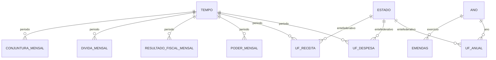

# RELATÓRIO — ATIVIDADE PRÁTICA 1

## Módulo 1: Fundamentos e Modelagem Inicial

| Campo | Valor |
|---|---|
| Disciplina | Atividades Práticas de Pós — Engenharia de Dados (CB_01_2026) |
| Aluno | _[preencher: nome completo]_ |
| Turma | CB_01_2026 |
| Cenário | **Dataset público** — dados abertos do Governo Federal (Tesouro Nacional, SIOP, SICONFI, BCB) |
| Data | _[preencher: local e data]_ |
| Repositório | `AnaliseDadosGovernoFederal` — pipeline Python + dashboard React estático |

> **Passo inicial 1 (Carta de Apresentação):** como a opção é por **dataset público**, a carta deve ser preenchida apontando o **local de coleta** dos dados — os portais oficiais listados na Seção 1.1 (fontes). Modelo em `docs/curso/carta-de-apresentacao-pratica.pdf`.
>
> **Passo inicial 2 (Termo de Autorização):** idem — preencher o termo declarando tratar-se de **dados públicos**, sem necessidade de acesso a instalações de terceiros. Modelo em `docs/curso/termo-de-autorizacao-atividade-pratica.pdf`.

---

## 1. Cenário e fontes

### 1.1 Escolha do dataset

O projeto consolida **6 fontes oficiais** em um acervo único (`public/data/*.json`), com janela rolante de 10 anos (2016 → ano corrente):

| Fonte | O que fornece | Script de coleta |
|---|---|---|
| Tesouro Nacional — RTN (Tabela 1.1) | Receita, despesa e resultado primário mensal da União; tributos; grupos de despesa | `scripts/coletas/coleta.py` + `scripts/processamento/processa_rtn.py` |
| SIOP — Dados Abertos (RDF) | Execução orçamentária de todos os órgãos e Poderes | `scripts/coletas/coleta_orgaos_todos.py` |
| SICONFI/STN — RREO Anexo 1 | Balanço bimestral de estados e DF | `scripts/coletas/coleta_siconfi.py` |
| Banco Central — SGS | IPCA, Selic, dólar, IBC-Br, dívida pública, resultado fiscal | `scripts/coletas/coleta_conjuntura.py` |
| SIOP — Emendas parlamentares | RP 0/1/2/3/6/7/8 do exercício corrente | `scripts/coletas/coleta_emendas.py` |
| Yahoo Finance | Fechamento mensal do Ibovespa | `scripts/coletas/coleta_conjuntura.py` |

O pipeline é orquestrado por `scripts/atualizar.py` (8 etapas) e validado por `scripts/validar.py` antes de qualquer publicação.

---

## 2. Bloco A — Análise Exploratória e Tratamento (Python)

> Código completo: `scripts/analise/exploratoria.py` (EDA) · resumo gerado: `docs/relatorio/eda_resumo.md`

### 2.1 Tratamento de erros e exceções

Toda coleta é tolerante a falhas: cada fonte é isolada em `try/except`, com retry e degradação para a última base válida — uma API fora do ar nunca derruba o pipeline.

**Excerto — retry por ano no BCB SGS** (`scripts/coletas/coleta_conjuntura.py:55`):

```python
raw = None
for t in range(3):
    try:
        raw = get_json(url)
        break
    except Exception as e:
        if t == 2:
            print(f"[bcb:{nome}:{a}] aviso apos retry: {e}")
        else:
            time.sleep(5 * (t + 1))
if raw is None:
    continue          # ano perdido: serie continua sem ele, sem quebrar
```

**Excerto — fallback de download do RTN** (`scripts/coletas/coleta.py:46`):

```python
try:
    return download(url, dest)
except Exception as e:
    print(f"   Falha no XLSX descoberto, tentando fallback: {e}")
# ... URL alternativa conhecida; se tudo falhar, gera amostra de desenvolvimento
```

**Excerto — nunca sobrescrever com base vazia** (`scripts/coletas/coleta_conjuntura.py:164`):

```python
def salva(df_rows: list, csv_nome: str, json_nome: str):
    df = pd.DataFrame(df_rows)
    if len(df):
        df.to_csv(DATA / csv_nome, index=False)
        df.to_json(PUB / json_nome, orient="records", force_ascii=False)
    else:
        print(f"AVISO: {csv_nome} vazio — mantido anterior (se houver).")
```

### 2.2 Tratamento de tipos de dados

O rigor na conversão de tipos é a base dos pipelines resilientes (nota do manual).

**Excerto — leitura do XLSX do RTN: nulo → 0.0, data → `datetime`, escala R$ milhões → R$** (`scripts/processamento/processa_rtn.py:18`):

```python
dates = [pd.to_datetime(h) for h in header[1:] if h is not None]   # tipagem de data

def get_row(idx):
    vals = list(rows[idx][1:1+len(dates)])
    # valor vazio/nulo vira 0.0; o restante e forçado para float
    return pd.Series([float(v) if v not in (None, "") else 0 for v in vals],
                     index=dates)

mensal = pd.DataFrame({
    "mes": dates,
    "receita_total": RECEITA_TOTAL.values * 1e6,   # R$ milhões -> R$
    ...
})
```

**Excerto — normalização de data na exportação** (`scripts/processamento/export_json.py:42`):

```python
m["mes"] = pd.to_datetime(m["mes"]).dt.strftime("%Y-%m-%d")   # padrao ISO no JSON
```

### 2.3 Tratamento de valores nulos

**Excerto — merge que só substitui por valores não-nulos** (`scripts/coletas/coleta_conjuntura.py:81`):

```python
def mescla_existente(csv_nome, novos, chave="mes", corte=None) -> list:
    """Une com o CSV da coleta anterior, preferindo valores novos nao-nulos.
    Evita que uma janela de instabilidade do BCB (502) encolha a serie publicada."""
    ...
    for r in novos:
        k = str(r[chave])
        if k in por:
            base = por[k]
            for c, v in r.items():
                if v is not None and v == v:   # NaN != NaN (teste classico de NaN)
                    base[c] = v
```

**Política de nulos adotada (sem imputação):** nulo publicado permanece `NULL` — no JSON, no banco e no gráfico. Nenhum zero é inventado para não distorcer séries (ex.: IBC-Br com atraso, IPCA/dólar no fim da janela).

### 2.4 Validação estrutural pós-carga

**Excerto — reconciliação aritmética em `scripts/validar.py:53`** (rodado no fim de todo `atualizar.py`):

```python
for r in mensal:
    for k in ("mes", "receita", "despesa", "resultado_primario"):
        if k not in r:
            erros.append(f"mensal sem campo {k}: {r}"); break
    if abs((r.get("receita",0) - r.get("despesa",0)) - r.get("resultado_primario",0)) > 1000:
        erros.append(f"mensal inconsistente em {r.get('mes')}: receita-despesa != resultado")
# + reconciliacao detalhe x total nas UFs (tolerancia de 1% ou R$ 1 mil)
```

### 2.5 Resultados da EDA (`scripts/analise/exploratoria.py`)

**Qualidade por base** (8 bases processadas, 0 falhas de carga):

| base | linhas | nulos | duplicatas (linha/chave) |
|---|---|---|---|
| mensal | 127 | 0 | 0 / 0 |
| receitas | 1.651 | 0 | 0 / 0 |
| despesas | 1.016 | 0 | 0 / 0 |
| poderes | 127 | 0 | 0 / 0 |
| orgaos_todos | 531 | 0 | 0 / 0 |
| conj_mensal | 132 | 10 (IBC-Br com lacuna e ipca/dolar/ibov no fim da janela) | 0 / 0 |
| conj_fiscal | 129 | 0 | 0 / 0 |
| emendas | 7 | 0 | 0 / 0 |

**Integridade e continuidade:**

- `receita − despesa = resultado_primario`: **maior desvio R$ 0,000061** (arredondamento de ponto flutuante) — **0 linhas** fora da tolerância de R$ 1.000;
- série mensal RTN: 2016-01 → 2026-07, **0 meses faltantes**, 0 datas inválidas após `to_datetime(errors='coerce')`;
- série conjuntura: 2016-01 → 2026-12, **0 meses faltantes**;
- `Receita Total − Transferências = Receita Líquida`: confere em **100%** dos meses.

**Outliers (Tukey 1,5 × IQR) — `resultado_primario`:**

- Q1 = −26.473,22 mi · Q3 = 9.490,84 mi · limites [−80.419,32 mi ; 63.436,93 mi];
- **11 de 127 pontos (8,7%)** fora dos limites — todos em meses reais (dez/2020, eleições, pandemia): **mantidos**, são comportamento do fenômeno, não erro de carga;
- `receita`: **0 outliers**.

### 2.6 Correção de rótulos da EDA (aplicada)

Na primeira versão do pipeline, a soma das 13 linhas de tributo do gráfico de receitas atingia, em média, **209,4% da receita líquida**. A investigação cruzando o pipeline com a planilha-fonte (`rtn_serie_historica.xlsx`, linha 1.1) mostrou:

1. a série rotulada **"Outras RFB"** era, na fonte, o **subtotal "1.1 Receita Administrada pela RFB"** — que **já contém** IR, COFINS, PIS, CSLL, IPI, IOF e Importação. O pipeline somava o subtotal às próprias componentes (duplicação);
   - conferência 2024-01 (antes): "Outras RFB" = **198,7 bi** (valor idêntico ao da linha 1.1 da planilha) vs Receita Total 279,2 bi;
2. "Royalties/Petroleo" apontava a linha 24 ("Receitas Próprias") em vez da linha 23 ("Exploração de Recursos Naturais");
3. "Transf. Estados/Municipios" é uma **dedução** gravada como positiva — e `279,2 − 41,3 = 237,9 = Receita Líquida`, exatamente.

**Correção aplicada** em `scripts/processamento/processa_rtn.py` (`mapa_rec`: índices `6→16` e `24→23`), com regeneração de `public/data/receitas.json` e do banco:

| Série (2024-01) | Antes | Depois |
|---|---|---|
| Outras RFB | 198,7 bi (subtotal duplicado) | **3,7 bi** (residual real) |
| Royalties/Petroleo | 1,6 bi (Receitas Próprias) | **16,8 bi** (exploração de recursos) |

Após a correção, a soma das 12 linhas de tributo (sem a dedução) corresponde a **93,7% da Receita Total** em média (mín 82,4% / máx 97,4%) — o resíduo de ~6% são linhas não plotadas na fonte (salário-educação, contribuição de seguridade social, demais receitas não-administradas, CIDE). A leitura continua **por série, não por soma**; `Receita Total − Transf. = Receita Líquida` confere em 100% dos meses.

---

## 3. Bloco B — Modelagem de Dados (Entidade-Relacionamento)

> Arquivos: `scripts/banco/ddl.sql` (DDL) · `scripts/banco/dml_carga_inicial.sql` (DML) · `scripts/banco/gerar_dml.py` (gerador) · `scripts/banco/carregar.py` (carga)

### 3.1 Modelo conceitual (Entidade-Relacionamento)

**Diagrama A — Núcleo fiscal federal:**

```mermaid
erDiagram
    PODER {
        int cod_poder PK
        string nome
    }
    ORGAO {
        int cod_orgao PK
        string nome
        int cod_poder FK
    }
    ANO {
        int ano PK
    }
    EXECUCAO_ORGAO {
        int ano PK_FK
        int cod_orgao PK_FK
        float dotacao
        float empenhado
        float liquidado
        float pago
    }
    TEMPO {
        date mes PK
        int ano
    }
    RECEITA_MENSAL {
        date mes PK_FK
        float receita_total
        float receita_liquida
        float despesa
        float resultado_primario
    }
    TIPO_RECEITA {
        int cod_tipo PK
        string nome
    }
    RECEITA_TIPO {
        date mes PK_FK
        int cod_tipo PK_FK
        float valor
    }
    FUNCAO_DESPESA {
        int cod_funcao PK
        string nome
    }
    DESPESA_FUNCAO {
        date mes PK_FK
        int cod_funcao PK_FK
        float valor
    }
    ESTADO {
        string sigla PK
        string nome
        string status
        int populacao_ref
    }
    RECEITA_ANUAL {
        int ano PK
        float receita_total
        float receita_liquida
        float despesa
        float resultado_primario
    }
    UF_MENSAL {
        string sigla PK_FK
        date mes PK_FK
        int bimestre
        float receita
        float despesa
        float resultado_primario
    }
    PODER ||--o{ ORGAO : "classifica"
    ORGAO ||--o{ EXECUCAO_ORGAO : "executa"
    ANO ||--o{ EXECUCAO_ORGAO : "exercicio"
    TEMPO ||--o{ RECEITA_MENSAL : "periodo"
    TEMPO ||--o{ RECEITA_TIPO : "periodo"
    TIPO_RECEITA ||--o{ RECEITA_TIPO : "classifica"
    TEMPO ||--o{ DESPESA_FUNCAO : "periodo"
    FUNCAO_DESPESA ||--o{ DESPESA_FUNCAO : "agrupa"
    ESTADO ||--o{ UF_MENSAL : "entefederativo"
    TEMPO ||--o{ UF_MENSAL : "periodo"
    ANO ||--o{ RECEITA_ANUAL : "agrega"
```

**Diagrama B — Conjuntura e estados (sem atributos):**



### 3.2 Modelo lógico (mapeamento entidade → tabela)

**Dimensões:**

| Tabela | PK | Atributos | Origem |
|---|---|---|---|
| `poder` | `cod_poder` | `nome` (UNIQUE) | distinct de `orgaos_todos.poder` |
| `tipo_receita` | `cod_tipo` | `nome` (UNIQUE) | distinct de `receitas.tipo` |
| `funcao_despesa` | `cod_funcao` | `nome` (UNIQUE) | distinct de `despesas.funcao` |
| `periodo` | `mes` (AAAA-MM-01) | `ano` + CHECK de formato | união de todos os meses das bases |
| `estado` | `sigla` | `nome`, `status`, `fonte`, `periodicidade`, `resultado_conceito`, `populacao_ref` | 27 UFs + `uf/*/meta.json` |
| `orgao` | `cod_orgao` | `nome`, `cod_poder` → FK `poder` | `orgaos_todos` (nome mais recente por código) |

**Fatos:**

| Tabela | PK | FK | Medidas | Origem |
|---|---|---|---|---|
| `execucao_orgao` | (`ano`,`cod_orgao`) | `orgao` | dotação, empenhado, liquidado, pago | SIOP |
| `receita_mensal` | `mes` | `periodo` | receita_total, receita_liquida, despesa, resultado_primario (+ CHECK aritmético) | RTN |
| `receita_anual` | `ano` | — | idem | agregado da RTN |
| `receita_tipo` | (`mes`,`cod_tipo`) | `periodo`, `tipo_receita` | valor | RTN 1.1 |
| `despesa_funcao` | (`mes`,`cod_funcao`) | `periodo`, `funcao_despesa` | valor | RTN 1.1 |
| `poder_mensal` | `mes` | `periodo` | custeio_capital, despesa_total, participacao | RTN item 4.3.12 |
| `conjuntura_mensal` | `mes` | `periodo` | ipca_m, ipca_12m, dolar, selic, ibc, ibov | BCB/Yahoo |
| `divida_mensal` | `mes` | `periodo` | dbgg, dlsp (%, R$ bi) | BCB SGS |
| `resultado_fiscal_mensal` | `mes` | `periodo` | primario, juros, nominal | BCB SGS |
| `emendas` | (`ano`,`rp`) | — | dotação…pago | SIOP |
| `uf_mensal` | (`sigla`,`mes`) | `estado`, `periodo` | bimestre, receita, despesa, resultado | SICONFI RREO |
| `uf_receita` | (`sigla`,`mes`,`tipo`) | `estado`, `periodo` | valor | SICONFI RREO |
| `uf_despesa` | (`sigla`,`mes`,`funcao`) | `estado`, `periodo` | valor | SICONFI RREO |
| `uf_anual` | (`sigla`,`ano`) | `estado` | receita, despesa, resultado | SICONFI RREO |

**Restrições:** 6 FKs + `PRAGMA foreign_keys = ON`; CHECK de consistência em `receita_mensal`; CHECK de formato em `periodo.mes`; 4 índices em colunas de junção.

### 3.3 DDL — criação das tabelas

Arquivo completo: **`scripts/banco/ddl.sql`** (20 `CREATE TABLE` + 4 `CREATE INDEX`). Trecho:

```sql
-- Balanco mensal da Uniao (RTN 1.1)
CREATE TABLE receita_mensal (
    mes                TEXT PRIMARY KEY REFERENCES periodo (mes),
    receita_total      REAL NOT NULL,
    receita_liquida    REAL NOT NULL,
    despesa            REAL NOT NULL,
    resultado_primario REAL NOT NULL,
    -- regra de integridade: receita liquida - despesa = resultado primario
    CHECK (ABS((receita_liquida - despesa) - resultado_primario) < 1000)
);

-- Execucao anual por orgao superior (SIOP)
CREATE TABLE execucao_orgao (
    ano       INTEGER NOT NULL,
    cod_orgao INTEGER NOT NULL REFERENCES orgao (cod_orgao),
    dotacao   REAL NOT NULL DEFAULT 0,
    empenhado REAL NOT NULL DEFAULT 0,
    liquidado REAL NOT NULL DEFAULT 0,
    pago      REAL NOT NULL DEFAULT 0,
    PRIMARY KEY (ano, cod_orgao)
);

CREATE TABLE orgao (
    cod_orgao INTEGER PRIMARY KEY,
    nome      TEXT NOT NULL,
    cod_poder INTEGER NOT NULL REFERENCES poder (cod_poder)
);

CREATE INDEX idx_execucao_orgao ON execucao_orgao (cod_orgao);
```

### 3.4 DML — carga inicial

Arquivo: **`scripts/banco/dml_carga_inicial.sql`** — 8.717 linhas / 474 KB de `INSERT` literais, gerados a partir dos JSONs publicados por `scripts/banco/gerar_dml.py`, na ordem das dependências de chave estrangeira. Trecho:

```sql
INSERT INTO poder (cod_poder, nome) VALUES
  (1, 'DPU'),
  (2, 'Executivo'),
  (3, 'Judiciario'),
  (4, 'Legislativo'),
  (5, 'MPU');

INSERT INTO receita_mensal (mes, receita_total, receita_liquida, despesa, resultado_primario) VALUES
  ('2016-01-01', 141213240860.66364, 124043962618.36778, 109355209090.80223, 14688753527.565538),
  ('2016-02-01', 89700017919.85, 67554696153.250694, 92966421425.14272, -25411725271.89202),
  ('2016-03-01', 98324823162.27516, 84956621270.93576, 92786240597.6014, -7829619326.665634),
  ...
```

**Decisões de carga registradas:**

- `periodo` recebe **todos** os meses (132) antes dos fatos, para as FKs resolverem;
- nulos de origem (`ibc`, `dolar`, `ibov`…) viram **`NULL`**, nunca 0;
- `orgao.nome` guarda o **nome mais recente** por código (houve mudança de grafia ao longo dos anos — tratamento de homonímia/deriva de rótulo);
- UF sem coleta (`status = 'em-coleta'`) entram só na dimensão `estado`, sem fatos.

### 3.5 Resultado da carga (`python scripts/banco/carregar.py`)

```
1/3 executando ddl.sql ...
2/3 executando dml_carga_inicial.sql ...
3/3 verificando integridade ...        PRAGMA foreign_key_check → 0 violações

   poder                             5 linhas
   tipo_receita                     13 linhas
   funcao_despesa                    8 linhas
   periodo                         132 linhas
   estado                           27 linhas
   orgao                            64 linhas
   execucao_orgao                  531 linhas
   receita_mensal                  127 linhas
   receita_anual                    11 linhas
   receita_tipo                   1651 linhas
   despesa_funcao                1016 linhas
   poder_mensal                    127 linhas
   conjuntura_mensal               132 linhas
   divida_mensal                   129 linhas
   resultado_fiscal_mensal         129 linhas
   emendas                           7 linhas
   uf_mensal                       320 linhas
   uf_receita                     2240 linhas
   uf_despesa                     1900 linhas
   uf_anual                          55 linhas
   TOTAL                          8624 linhas

OK: data/observatorio.db criado (0.9 MB).
```

### 3.6 Consultas de exemplo (DML — SELECT)

**1. Receita × despesa × resultado por ano:**

```sql
SELECT ano, ROUND(receita_liquida/1e9,1) receita_bi,
       ROUND(despesa/1e9,1) despesa_bi,
       ROUND(resultado_primario/1e9,1) primario_bi
FROM receita_anual ORDER BY ano;
```

| ano | receita_bi | despesa_bi | primario_bi |
|---|---|---|---|
| 2016 | 1089,1 | 1250,4 | −161,3 |
| 2019 | 1347,3 | 1442,3 | −95,1 |
| 2020 | 1204,3 | 1947,6 | **−743,3** |
| 2022 | 1856,1 | 1809,7 | **+46,4** |
| 2025 | 2332,6 | 2394,2 | −61,7 |
| 2026* | 1481,9 | 1563,2 | −81,3 |

\* ano parcial (até jul/2026).

**2. Top 5 órgãos por pagamento (JOIN dimensão × fato):**

```sql
SELECT o.nome, ROUND(SUM(e.pago)/1e9,1) pago_bi
FROM execucao_orgao e JOIN orgao o USING (cod_orgao)
GROUP BY o.nome ORDER BY pago_bi DESC LIMIT 5;
```

| órgão | pago_bi (janela) |
|---|---|
| Dívida Pública Federal | 16.768,5 |
| Transferências a Estados, DF e Municípios | 4.243,7 |
| Ministério da Previdência Social | 3.697,1 |
| Ministério do Desenvolvimento e Assistência Social | 3.294,5 |
| Ministério da Fazenda | 2.470,0 |

**3. Imposto de Renda por ano (junção com a dimensão de tributos):**

```sql
SELECT SUBSTR(r.mes,1,4) ano, ROUND(SUM(r.valor)/1e9,1) ir_bi
FROM receita_tipo r JOIN tipo_receita c USING (cod_tipo)
WHERE c.nome = 'Imposto de Renda' GROUP BY ano ORDER BY ano;
```

| ano | 2016 | 2018 | 2020 | 2022 | 2024 | 2025 |
|---|---|---|---|---|---|---|
| ir_bi | 341,1 | 362,8 | 384,1 | 667,2 | 785,2 | 867,3 |

**4. Resultado orçamentário médio dos estados com dados (SICONFI):**

```sql
SELECT e.nome, COUNT(*) meses, ROUND(AVG(u.resultado_primario)/1e9,2) media_bi
FROM uf_mensal u JOIN estado e ON e.sigla = u.sigla
GROUP BY e.nome ORDER BY media_bi DESC;
```

| UF | meses | média bimestral (R$ bi) |
|---|---|---|
| São Paulo | 64 | 4,85 |
| Minas Gerais | 64 | 2,14 |
| Rio de Janeiro | 64 | 1,27 |
| Rio Grande do Sul | 64 | 1,12 |
| Paraná | 64 | 0,85 |

---

## 4. Bloco C — Diagnóstico Estatístico (Statistics for Data Science)

> Código: `scripts/analise/estatistica.py` · resultados completos: `docs/relatorio/estatistica_resultados.md`

### 4.1 Amostra escolhida

- **Variável:** `resultado_primario` mensal da União (receita líquida − despesa), RTN Tabela 1.1 — Tesouro Nacional;
- **Período:** 2016-01 → 2026-07 (janela rolante de 10 anos do pipeline);
- **n = 127 observações mensais** — série temporal completa da janela (censos dos meses publicados);
- Ferramentas: `scipy.stats` + `numpy`.

### 4.2 Medidas de posição (R$ milhões/mês)

| medida | valor |
|---|---|
| média | **−12.969,76** |
| mediana | **−15.540,20** |
| 1º quartil (Q1) | −26.473,22 |
| 3º quartil (Q3) | 9.490,84 |
| percentil 10 | −55.256,86 |
| percentil 90 | 28.879,33 |

- Leitura: média acima da mediana em R$ 2.570,44 mi; assimetria medida = −0,718 (cauda esquerda mais longa — o mínimo distancia-se mais da mediana que o máximo). Por isso média e mediana são reportadas juntas.

### 4.3 Medidas de variabilidade

| medida | valor |
|---|---|
| mínimo | −194.853,11 |
| máximo | 86.996,64 |
| amplitude | 281.849,74 |
| variância (amostral, ddof=1) | 1.588,32 (R$ bi)² |
| desvio padrão | 39.853,69 |
| coeficiente de variação | **307,3%** |

- CV elevado é esperado: série crua (nominal), sem dessazonalizar, com saltos de dezembro e choques (2020, eleições).

### 4.4 Diagnóstico de normalidade

| teste/medida | valor |
|---|---|
| Shapiro-Wilk (W) | 0,9359 |
| Shapiro-Wilk (p-valor) | **< 0,001** |
| assimetria (skewness) | −0,718 |
| curtose (excesso) | 3,496 |

- Decisão (α = 0,05): **rejeita H₀ — a série não é normal**. Consequência metodológica: os testes t são usados com a correção de Welch e confrontados com alternativa não paramétrica (Seção 4.5), e a leitura estatística prioriza mediana/quartis.

### 4.5 Testes de hipótese

#### 5.1 Teste t de uma amostra — a média do resultado primário é zero?

- **H₀:** μ = 0 · **H₁:** μ ≠ 0 (bicaudal) · **α = 0,05**
- Estatística: **t = −3,667** · **gl = 126** · **p < 0,001**
- **Decisão: REJEITA H₀** — a média mensal difere de zero: déficit primário médio de **R$ 12.969,76 mi/mês** na janela.
- Interpretação: o Governo Central teve, em média, despesa acima da receita líquida no período analisado — déficit primário médio estatisticamente significativo.

#### 5.2 Teste t de Welch — receita líquida média: 2016-2020 × 2021-2025

- **H₀:** μ₁ = μ₂ · **H₁:** μ₁ ≠ μ₂ (bicaudal) · **α = 0,05**
- 2026 excluído: ano incompleto (até jul) distorceria a média do grupo.

| grupo | n | média (R$ mi/mês) | desvio padrão (R$ mi) | Shapiro p |
|---|---|---|---|---|
| 2016-2020 | 60 | 100.471,97 | 23.439,38 | 0,0030 |
| 2021-2025 | 60 | 163.849,51 | 36.429,77 | 0,1014 |

- Estatística (Welch): **t = −11,333** · **p < 0,001** · **α = 0,05**
- **Decisão: REJEITA H₀** — a receita líquida média mensal **mudou** entre os períodos.
- Tamanho do efeito: **Cohen d = +2,07 (efeito grande)** — variação relativa de **+63,1%** na média mensal.

#### 5.3 Mann-Whitney U — alternativa não paramétrica

- Mesmos grupos; não exige normalidade (relevante porque o Shapiro rejeitou normalidade no grupo 2016-2020).
- **U = 211** · **p < 0,001** · **α = 0,05**
- **Decisão: REJEITA H₀** — **converge** com o teste t de Welch: a diferença entre períodos não é artefato da não-normalidade.

#### 5.4 Premissas declaradas

- **Independência entre meses:** razoável para série fiscal agregada (autocorrelação não investigada — limitação declarada);
- **Normalidade:** aferida por Shapiro-Wilk em cada grupo (p = 0,0030 e p = 0,1014); com n = 60 por grupo, o teste t de Welch é robusto sob leve não-normalidade, e o Mann-Whitney confirma;
- **Variâncias desiguais:** tratadas pela correção de Welch (`equal_var=False`);
- **Amostra não aleatória:** são meses publicados da janela completa — a inferência vale para o processo gerador desses meses, não para "todos os meses da história".

### 4.6 Convergência banco ↔ estatística (validação cruzada)

`SELECT AVG(resultado_primario) FROM receita_mensal` → **−12.969,76 mi** — idêntico ao calculado em Python (numpy), confirmando que o DML carregou os valores sem perda de precisão.

---

## 5. Como reproduzir

```bash
# 1) EDA e tratamento -> docs/relatorio/eda_resumo.md
python scripts/analise/exploratoria.py

# 2) Diagnostico estatistico -> docs/relatorio/estatistica_resultados.md
python scripts/analise/estatistica.py

# 3) Modelagem: gerar DML, criar e validar o banco SQLite
python scripts/banco/gerar_dml.py     # regenera dml_carga_inicial.sql
python scripts/banco/carregar.py      # cria data/observatorio.db (DDL + DML + checagens)

# 4) (opcional) atualizar a base oficial e revalidar
python scripts/atualizar.py
```

Dependências Python: `scripts/requirements.txt` (pandas, numpy, scipy, openpyxl, …).

---

## 6. Pendências e recomendações

1. **Carta de Apresentação** — preencher o modelo apontando os locais de coleta (portais oficiais da Seção 1.1) e declarando tratar-se de dataset público;
2. **Termo de Autorização** — preencher o modelo declarando **dados públicos**, sem coleta em dependências de terceiros;
3. ~~**Correção de rótulo na EDA**~~ — **aplicada** (ver Seção 2.6): `scripts/processamento/processa_rtn.py` (`mapa_rec` 6→16 e 24→23), `receitas.json`, banco e EDA regenerados. Corrigia "Outras RFB" (subtotal duplicado, 198,7→3,7 bi) e "Royalties/Petroleo" (linha errada, 1,6→16,8 bi) em 2024-01;
4. **Entrega** — este relatório em Markdown pode ser convertido para PDF/DOCX conforme preferência da coordenação.
